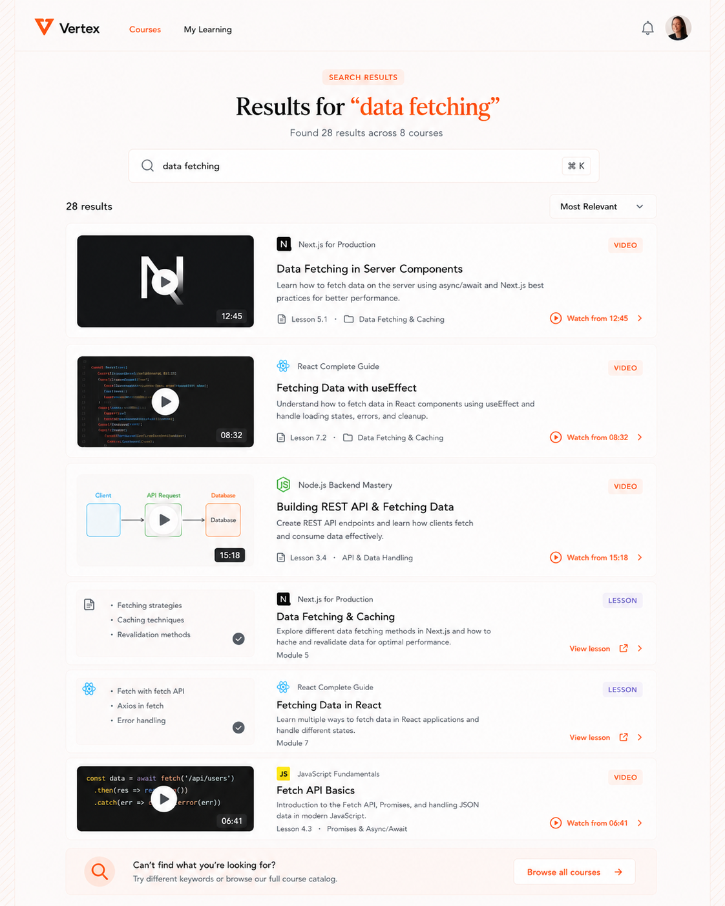
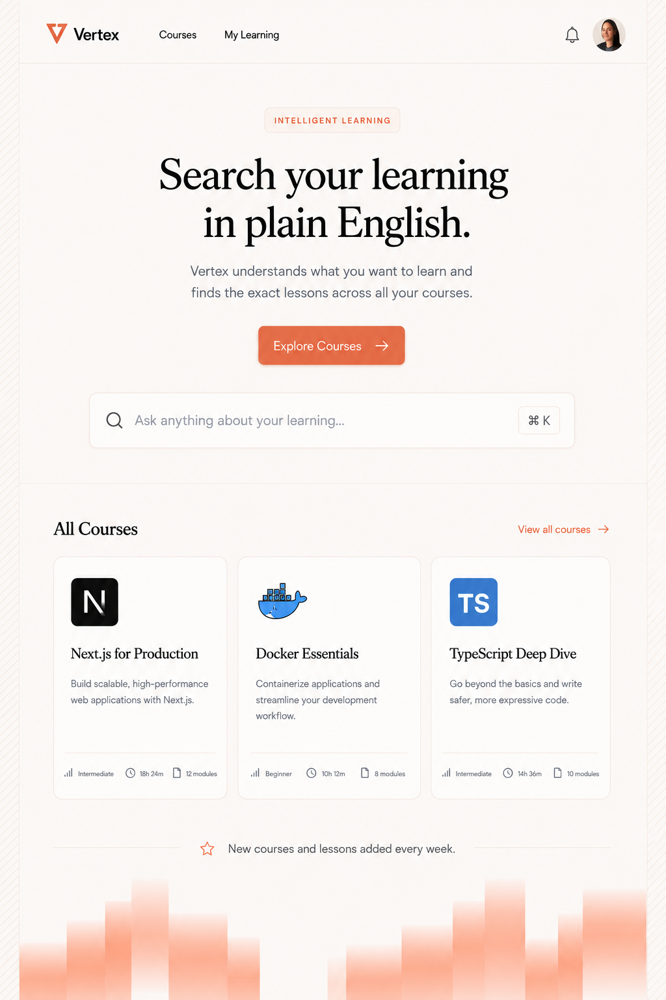
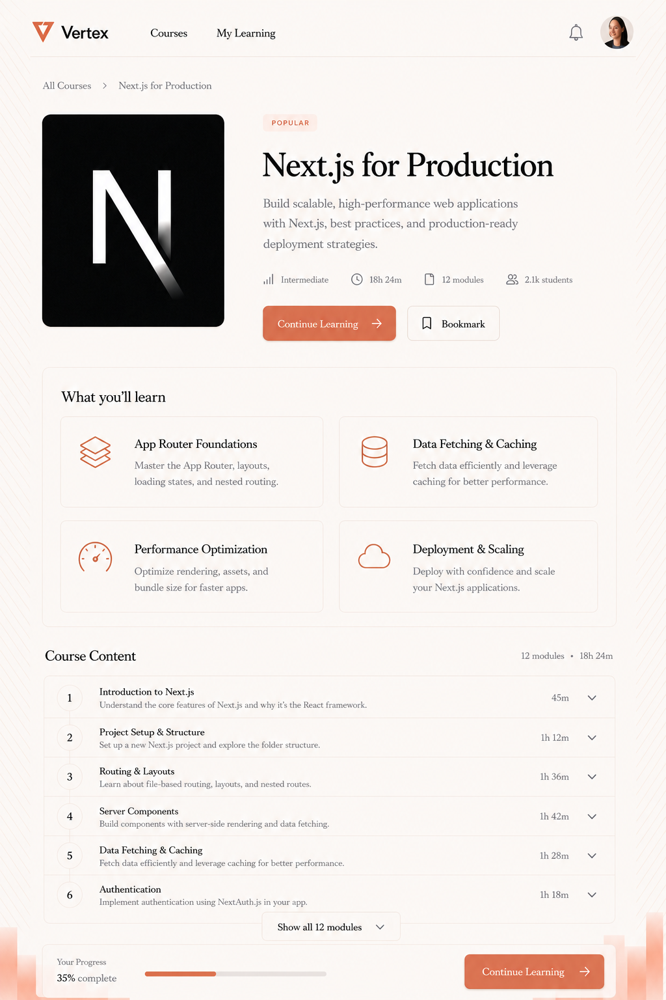
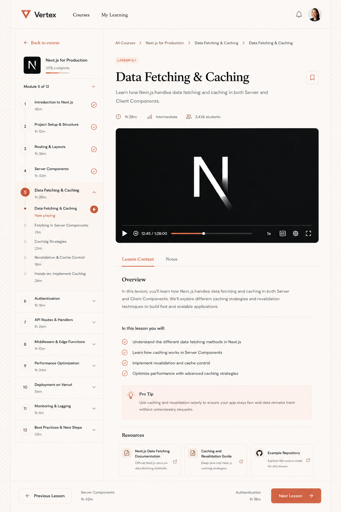
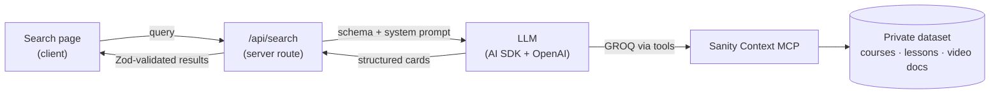

# Vertex

[](https://github.com/Jcoley-Mercurius/vertex-learning-platform/actions/workflows/ci.yml)

An AI-powered learning platform with search that links straight to the exact second
a topic is taught in a lesson video.

**Live demo: [mercurius-vertex.vercel.app](https://mercurius-vertex.vercel.app)**



<p>
  
  
  
</p>

<sub>The desktop reference designs the UI was built to match.</sub>

## What it does

Authors create courses in Sanity, and a Next.js site serves them to learners. What sets it
apart is search. A learner types a plain-language query and gets back a full, ranked results
page with two kinds of card:

- **Video moments**: a lesson's video matched at a specific second. "Watch from 4:12" opens
  the lesson page, and the embedded player starts right there, on the site.
- **Lessons**: a lesson matched on its topic, with its key points.

Around search sits the rest of a learning product:

- A catalog, course pages with modules and outcomes, lesson pages (video plus notes, key
  points, resources), and instructor pages.
- Clerk accounts. Browsing is public, and learner state is private.
- Progress per learner: completed lessons and a resume position, shown as completion marks
  and "continue" affordances across the catalog, course and lesson pages.
- My Learning, course and lesson bookmarks, personal lesson notes, and a notification feed.
- PostHog analytics for catalog and lesson views, searches, video plays and watch depth,
  and completions.

### Try it

Sign in (search needs an account), then search for something like:

- `caching and revalidation`
- `when does useMemo actually help`
- `chunking documents for RAG`

The demo has a small daily search quota per account. A repeat query is served from cache
and doesn't count against it.

## How search works



- The server route connects to the **Sanity Context MCP**, gives the model the schema and a
  system prompt, and lets it write GROQ over the content. The model's output is structured
  card data validated with Zod, not chat prose.
- Lessons are matched on their title and a plain-text projection of their notes.
- Video moments resolve in two stages. A **video document** per unique video holds the
  chapter markers and the transcript split into short timestamped chunks. Chapters are
  matched first, and the noisier transcript is the fallback. Only the few matching chunks
  are fetched, never a whole transcript.
- Results are grounded. Every course, lesson, timestamp and count comes from the dataset.
  Video documents are an internal lookup and only surface tied to the lesson that uses them.
- Query guidance lives both in the inline system prompt and in a Sanity Context document,
  so it can be tuned in the Studio without a deploy.

### Cost and abuse guards

Every search is a billed model call, and the demo is public, so the route stacks its limits:

- A Clerk session is required.
- A per-minute limiter per learner.
- Durable **daily quotas per learner and site-wide**, counted in Sanity with an atomic
  increment, so they hold across serverless instances (`lib/search/quota.ts`).
- A **24-hour result cache** per normalized query. Repeats cost nothing.
- A `SEARCH_ENABLED=false` **kill switch** that stops search before any model call.

## Architecture

The repo holds two standalone workspaces:

| Workspace | What it is | Dev URL |
|---|---|---|
| repo root | The Next.js web app: pages, search UI, all server-side integration | http://localhost:3000 |
| `studio/` | Sanity Studio: the content schema, authoring, and offline tooling | http://localhost:3333 |

They are deliberately separate. The Studio builds on Vite, auto-updates itself, and deploys
independently of the site. The Context MCP also requires a deployed Studio.

Boundaries the web app keeps:

- **The dataset is private.** All content is fetched server-side with a read token. No
  Sanity token, OpenAI key or Clerk secret ever reaches the browser.
- **The browser never writes.** Progress, bookmarks, notes and notification state go
  through server routes (`/api/progress`, `/api/notifications`). The learner id always comes
  from the Clerk session, never from the request.
- **Pages are read-only.** They render stored data.
- **Video ingestion is offline.** It never runs in the request path.

## Stack

Next.js (App Router) · React · TypeScript · Tailwind CSS · Sanity (Studio, GROQ, TypeGen,
Portable Text) · Sanity Context MCP · Vercel AI SDK with OpenAI · Zod · Clerk · PostHog ·
Vercel

## Setup

```bash
# web app
npm install
cp .env.example .env.local     # then fill it in

# studio
cd studio && npm install
cp .env.example .env.local     # SANITY_STUDIO_PROJECT_ID / _DATASET
```

`.env.example` is the canonical list of variables and marks which are server-only.

The Sanity dataset is **private**. The web app needs a `SANITY_API_READ_TOKEN`
(Sanity Manage → API → Tokens → Add token, **Viewer** permissions). It is read only
from `sanity/lib/token.ts`, which is `server-only`. Learner writes need a separate
`SANITY_API_WRITE_TOKEN` (**Editor**), used only inside server routes.

Add the web app's origin to the project's CORS origins so the Studio and the app can
both reach the dataset:

```bash
cd studio && npx sanity cors add http://localhost:3000 --credentials
```

### Content and videos

```bash
cd studio
npm run seed        # import the sample catalog (10 courses, 120 lessons)
npm run videos      # build the video documents: chapters + transcript chunks
npm run deploy      # deploy the Studio (required before the Context MCP serves the dataset)
```

Video ingestion needs [`yt-dlp`](https://github.com/yt-dlp/yt-dlp)
(`pip install --user yt-dlp`). See `studio/scripts/videos/README.md`.

## Running

```bash
npm run dev                  # web app on :3000
npm --prefix studio run dev  # studio on :3333
```

## Content model

Six document types, defined in `studio/schemaTypes/documents/`:

- **Course**: marketing fields, learning outcomes, and an ordered list of embedded
  **modules**, each holding references to lessons. Module and lesson numbers ("Module 5",
  "Lesson 5.1") are derived from array order and never stored.
- **Lesson**: video URL, poster, duration, Portable Text notes, key points, a pro tip,
  and resources. A lesson does not store its parent course. The frontend resolves it with
  a reverse reference.
- **Instructor** and **Category**: referenced by courses, each with its own page.
- **Video**: built by the ingestion pipeline, one per unique video URL. It holds the
  chapters and the timestamped transcript chunks. It is a search lookup, never shown as
  content.
- **Progress**: per-learner app state keyed by the Clerk user id. It is written only
  through server routes and kept apart from the read-only content.

## Data access

All content is read server-side. `sanity/lib/queries.ts` holds every GROQ query,
wrapped in `defineQuery` so TypeGen types the results.

```bash
npm run typegen   # regenerates sanity.types.ts from the schema and the queries
```

Types also regenerate automatically while `sanity dev` is running.

## Checks

```bash
npx tsc --noEmit
npm run lint
npm run build
```

CI runs the type check and lint on every push and pull request. Vercel builds every pull
request as a preview deploy.

## How it was built

Vertex was built with an AI coding agent working to a written spec. `AGENTS.md` holds the
architecture rules and the decisions that were already made. Every feature started as an
implementation prompt in [`prompts/`](prompts/): goal, code inspected, decisions,
security considerations, acceptance criteria, and test steps. Each prompt was approved
before any code was written, and the UI was reproduced from the reference designs in
[`design/`](design/).

## License

[MIT](LICENSE)
